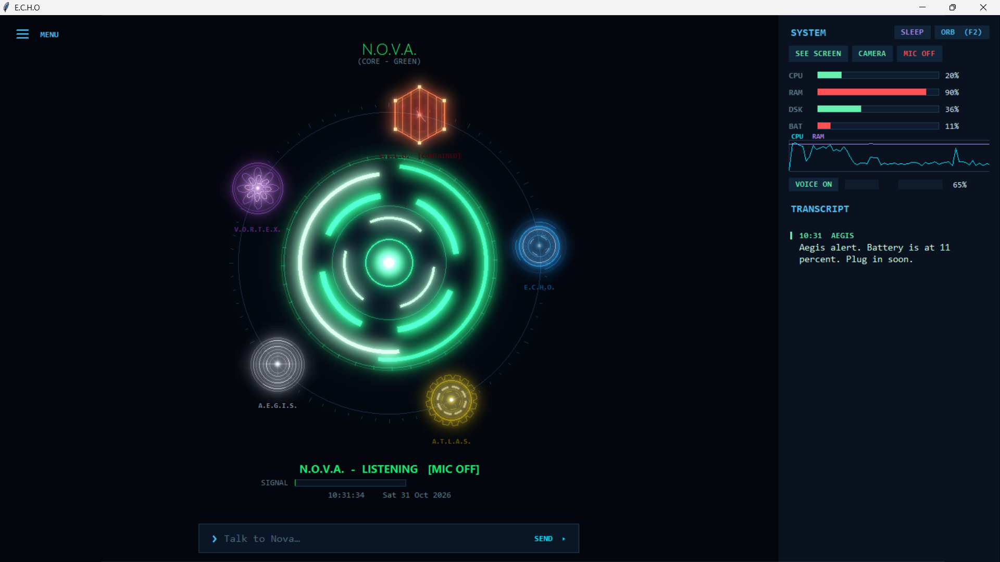

# Mini-Jarvis

An offline voice assistant for Windows that runs on a local LLM with Ollama. No cloud and no subscription. It has six assistants, each with its own voice, color, animated arc reactor, and job.



## Features

- Runs fully offline (Ollama, llama3.2:3b)
- Voice lock: only responds to your registered voice (Resemblyzer)
- Open and close apps, search the web, control volume by voice
- Interruptible by saying "stop", plus a sleep mode that cuts CPU and RAM usage
- Floating orb mode, mic mute, global wake shortcut
- Screen and camera vision, with drag and drop images
- Google Calendar through a read-only iCal link, with an offline cache
- Reads and sends WhatsApp and Instagram messages, with live alerts (browser automation)
- Asks "should I remember that?" before saving anything

## The Assistants

| Name | Role |
|------|------|
| Echo | Daily driver |
| Nova | Code help |
| Aegis | System monitor and security |
| Atlas | Heavy data and storage |
| Vortex | Web gathering |
| Silo | Kept in containment. Do not call him. |

## Requirements

- Windows 10/11
- Python 3.10+
- [Ollama](https://ollama.com/)
- A microphone

## Installation

1. Pull the model:
   ```bash
   ollama pull llama3.2:3b
   ```
2. Clone the repo:
   ```bash
   git clone https://github.com/shreyasbalhey128-droid/Mini-Jarvis.git
   cd Mini-Jarvis
   ```
3. Create a virtual environment and install dependencies:
   ```bash
   python -m venv venv
   venv\Scripts\activate
   pip install -r requirements.txt
   playwright install
   ```
4. Put your secret Google Calendar iCal link in a text file in the project folder (the same file name the code reads, see `calendar_agent.py`).
5. Download the models (they are not included in this repo):
   - Vosk speech model `vosk-model-small-en-us-0.15` from https://alphacephei.com/vosk/models, unzipped into the project folder
   - Piper voice files into a folder called `voices`
6. Run it:
   ```bash
   python voice.py
   ```
7. Say "register my voice" the first time to set up the voice lock.

## Disclaimer

This is a personal project. The WhatsApp and Instagram features use browser automation on your own accounts, so use them at your own risk, since platforms may restrict automated use. Your voice profile, memories, and login sessions stay on your machine and are not part of this repo.

## Roadmap

- Run on a Raspberry Pi as a small home server
- More vision and screen-reading features

## License

MIT (see the LICENSE file)

## Author

Made by [Shreyas](https://github.com/shreyasbalhey128-droid)